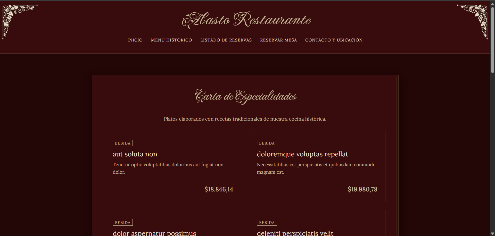
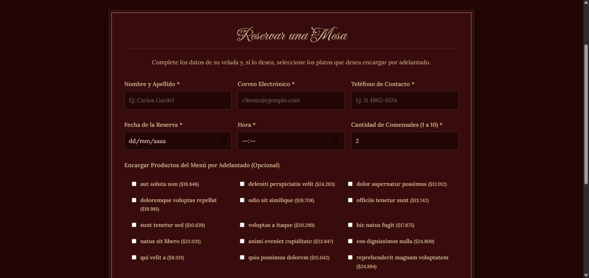
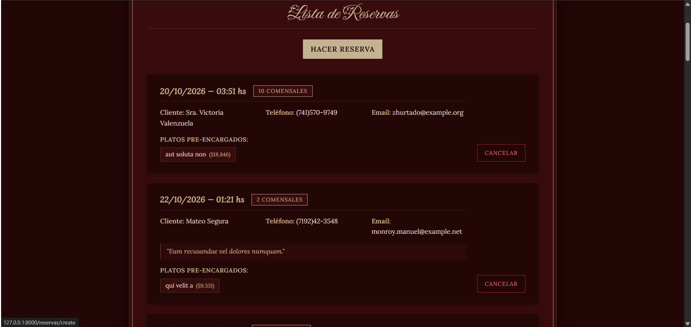

# Abasto Restaurante

Aplicación web para consultar el restaurante, ver el menú y gestionar reservas.

**Estudiante:** Lucas Ezequiel Pérez Arce

**Restaurante:** Abasto Restaurante

## Requisitos

- PHP 8.3 o superior
- Composer
- MySQL en ejecución

## Instalación y ejecución

Desde PowerShell, ubicarse en la carpeta del proyecto y seguir estos pasos:

1. Crear el archivo de configuración local si todavía no existe:

   ```powershell
   if (!(Test-Path .env)) { Copy-Item .env.example .env }
   ```

2. Instalar las dependencias:

   ```powershell
   composer install
   ```

3. Crear una base de datos MySQL, por ejemplo `abasto_restaurante`, y configurar en `.env` la conexión. Ajustar usuario y contraseña según la instalación local:

   ```dotenv
   DB_CONNECTION=mysql
   DB_HOST=127.0.0.1
   DB_PORT=3306
   DB_DATABASE=abasto_restaurante
   DB_USERNAME=root
   DB_PASSWORD=
   ```

4. Generar la clave de la aplicación:

   ```powershell
   php artisan key:generate
   ```

5. Crear las tablas y cargar los datos de prueba:

   ```powershell
   php artisan migrate:fresh --seed
   ```

   **Atención:** `migrate:fresh` elimina todas las tablas de la base configurada antes de recrearlas. Usarlo solo en un entorno local cuyos datos se puedan borrar.

6. Iniciar el servidor local:

   ```powershell
   php artisan serve
   ```

   Abrir [http://127.0.0.1:8000](http://127.0.0.1:8000) en el navegador.

## Rutas

| Método | URL | Controlador |
| --- | --- | --- |
| GET | `/` | `PaginaController@inicio` |
| GET | `/menu` | `PaginaController@menu` |
| GET | `/contacto` | `PaginaController@contacto` |
| GET | `/reservas` | `ReservaController@index` |
| GET | `/reservas/create` | `ReservaController@create` |
| POST | `/reservas` | `ReservaController@store` |
| DELETE | `/reservas/{reserva}` | `ReservaController@destroy` |

## Relación entre productos y reservas

La relación elegida es **muchos a muchos**. Una reserva puede incluir varios productos encargados por adelantado y un mismo producto puede estar asociado a varias reservas.

La migración `create_producto_reserva_table` implementa la tabla pivote `producto_reserva`, que contiene las claves foráneas `reserva_id` y `producto_id`, además de las marcas de tiempo. Ambas claves eliminan sus registros relacionados de la tabla pivote en cascada cuando se elimina la reserva o el producto.

En los modelos, `Producto::reservas()` y `Reserva::productos()` declaran la relación con `belongsToMany()` y `withTimestamps()`. Al guardar una reserva, `ReservaController` asocia los productos seleccionados mediante `attach()`.

## Capturas de pantalla

Guardar las imágenes PNG en `docs/capturas/` con estos nombres para que aparezcan aquí:

### Inicio



### Formulario de reserva



### Listado de reservas


